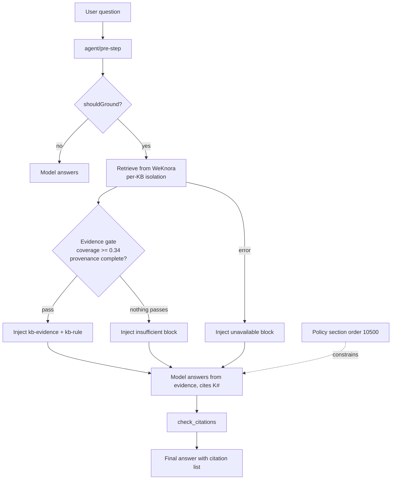

# WeKnora_plugin_byDHS

A grounding plugin that connects **DeepSeek Harness (DSH)** to a **WeKnora** knowledge base.

Once installed, answers about organizational knowledge are no longer "the model may or may not
search": the host retrieves evidence **before** the model sees the question, injects it as a
`<kb-evidence>` block, and the model must answer from those passages, cite them as `[K#]`, and
list `document name + knowledge_id + chunk index`. When retrieval finds nothing usable, the model
must say so instead of guessing.

> `byDHS` means **by DeepSeek Harness** — "built for DSH". It is not a person or team initials.
> The npm name is `weknora-plugin-bydhs` (npm does not allow capitals); the plugin identity and
> display name are `WeKnora_plugin_byDHS`.

- Version 0.4.0 · MIT · zero runtime dependencies, plain ESM, no build step
- Compatibility: see [COMPATIBILITY.md](COMPATIBILITY.md) (tested with DSH 0.2.x / WeKnora v0.9.0)
- Getting started: [HANDOVER.md](HANDOVER.md) · Acceptance checklist: [TESTING.md](TESTING.md)
- 中文说明：[README.md](README.md)

## What it solves

| Problem | Symptom | What this plugin does |
| --- | --- | --- |
| The model answers without searching | A knowledge base exists, the model makes things up | `agent/pre-step` retrieves and injects evidence before the model sees the question |
| Evidence is weak | Vector search always returns "closest" passages, low-score chunks get treated as facts | Deterministic gate: lexical coverage ≥ 0.34 **and** provenance fields present |
| Citations do not match | The answer cites a source that does not exist | `check_citations` verifies every `[K#]` and inline `knowledge_id + chunk` against the retrieved pages |

## Tools

Default prefix `wkg` (`toolPrefix` changes it):

| Tool | Purpose |
| --- | --- |
| `search` | Hybrid retrieval with the evidence gate; returns passages, `knowledge_id`, chunk index, `coverage`, `[K#]` markers and gate diagnostics |
| `read` | Read one document's stored chunks in order (paged) |
| `ask` | Let WeKnora compose its own cited answer (RAG or ReAct pipeline) |
| `check_citations` | Verify a draft answer's citations against the evidence retrieved in this session |
| `list_knowledge_bases` | List the knowledge bases this credential can see |
| `wiki_search` | Search WeKnora Wiki pages (topic/entity pages generated from the KB) |
| `wiki_read` | Read one wiki page by slug, with its source references and links |

All tools declare `parameters` and `output.schema` and pass the Harness'
`assertSupportedJsonSchema` validator (`scripts/verify-schemas.mjs`).

## How it works



Plain-text version:

```text
question
  -> agent/pre-step (host, this plugin)
       1. shouldGround?  chit-chat / code syntax / too short -> skip
       2. retrieve (one call per KB when several are configured)
       3. gate: coverage >= minCoverage and knowledge_id + chunk_index present
            pass    -> inject <kb-evidence> [K1]... + <kb-rule>
            nothing -> inject insufficient="true"
            error   -> inject unavailable="true"
       4. the same turn is not re-retrieved (deduped by user message id)
  -> agent/request: grounded sessions get temperature <= 0.2
  -> model answers from the evidence and cites [K#]
```

## Install

1. Put the key into the DSH credential store (never into the patch file):

```yaml
# ~/.dsh/.credentials.yaml
refs:
  WEKNORA_API_KEY: sk-your-read-only-key
```

2. Install the package:

```text
plugin_manager(action="install_bundle", target="file:/path/to/WeKnora_plugin_byDHS")
```

or on Windows:

```powershell
.\install.ps1 -Profile desktop -BaseUrl 'http://localhost:8080/api/v1' -KnowledgeBaseIds '<your-kb-id>'
```

3. Add the row to `<profile>/cordis.patch.yml` (copy `examples/cordis.patch.example.yml`):

```yaml
- id: WeKnora_plugin_byDHS
  name: "weknora-plugin-bydhs"
  disabled: false
  config:
    baseUrl: 'http://localhost:8080/api/v1'
    apiKeyRef: WEKNORA_API_KEY
    knowledgeBaseIds:
      - <your-kb-id>
```

A patch **replaces** the row's whole config, so restate every field you want to keep.
`!!js` expressions must be quoted as a whole, otherwise YAML truncates at `: ` and the row
fails to load.

4. Restart or reload, then look for:

```text
WeKnora_plugin_byDHS: registered wkg_search, wkg_read, wkg_ask, wkg_check_citations,
wkg_list_knowledge_bases, wkg_wiki_search, wkg_wiki_read + grounding policy ...
```

## Configuration

| Field | Default | Notes |
| --- | --- | --- |
| `baseUrl` | `http://localhost:8080/api/v1` | WeKnora API root; a bare origin gets `/api/v1` appended |
| `apiKey` / `apiKeyRef` | — / `WEKNORA_API_KEY` | Prefer the credential-store reference |
| `knowledgeBaseIds` | `[]` | Default scope; empty = every KB the credential can see |
| `agentId` | — | Makes `ask` use the ReAct pipeline |
| `toolPrefix` | `wkg` | Rename tools (`weknora` → `weknora_search`) |
| `enforce` | `true` | "must" / "should" wording |
| `injectEvidence` | `true` | `false` = tools only |
| `policyOrder` | `10500` | Renders after the first-party persona suffix (10200) |
| `minQueryChars` | `8` | Shorter messages are treated as chit-chat |
| `minCoverage` | `0.34` | Lexical coverage a passage must reach to count as evidence |
| `minScore` | — | Optional absolute floor for normalised scores |
| `maxInjectedChars` | `4000` | Budget for one injected block, rules included |
| `injectTopK` | `6` | Passages requested for the injection |
| `temperatureCap` | `0.2` | Sampling cap on grounded sessions; `null` disables |
| `perKbIsolation` | `true` | One broken KB cannot empty the evidence page |
| `tenantId` | — | Sends `X-Tenant-ID` for platform-scoped keys |
| `extraHeaders` | — | Extra headers for gateways/proxies |
| `maxRetries` | `1` | Retries for 429/5xx/network; `0` disables |
| `maxWikiChars` | `8000` | Character budget for one wiki page |
| `maxResults` / `maxChunkChars` | `6` / `1500` | Tool result size |
| `requestTimeoutMs` / `chatTimeoutMs` | `30000` / `300000` | Retrieval / answer timeouts |
| `resourceUrls` | `handle` | Keep `handle` for KB-restricted keys |

## Verify

```powershell
node --test                                  # 66 unit tests, no network
node scripts/doctor.mjs                      # ordered environment check (OK/WARN/FAIL)
node scripts/verify-live.mjs --query "..."   # 28 live checks against a real WeKnora
node scripts/mock-weknora.mjs --port 18090   # offline mock, no WeKnora needed
node scripts/verify-schemas.mjs              # JSON-Schema check with the Harness validator
```

## Data boundary and privacy

- Read-only: the plugin never writes to WeKnora (no ingestion, no chunk edits, no deletion).
- The API key is resolved from the DSH credential store and is never logged.
- No telemetry: the only network target is the configured `baseUrl`.
- Where the data lives depends on the WeKnora deployment (local SQLite/PostgreSQL or a remote
  server). Retrieval and answers may call remote model providers configured **in WeKnora** — the
  plugin itself does not call any model API.
- Retrieved text is injected as user-role content with `<` escaped to `\u003c`, so a document
  cannot close the `<kb-evidence>` block or forge citation markers.

## Limitations

- Injection happens on steps that carry a user message; mid-turn `steer`/`followup` messages are
  grounded separately.
- `check_citations` only sees evidence pages recorded in this process for this session.
- Citation *fidelity* (does the passage actually support the sentence) is not judged.
- Coverage is lexical: synonyms are not recognised. The threshold is deliberately low to favour
  recall; the citation check and the conflict rule do the rest.
- Wiki search is literal, case-insensitive matching; the `regex` flag is forwarded for deployments
  that support it.

## Contributing and license

See [CONTRIBUTING.md](CONTRIBUTING.md) and [SECURITY.md](SECURITY.md). MIT licensed.
This is an unofficial community plugin; it is not affiliated with Tencent or DeepSeek.
